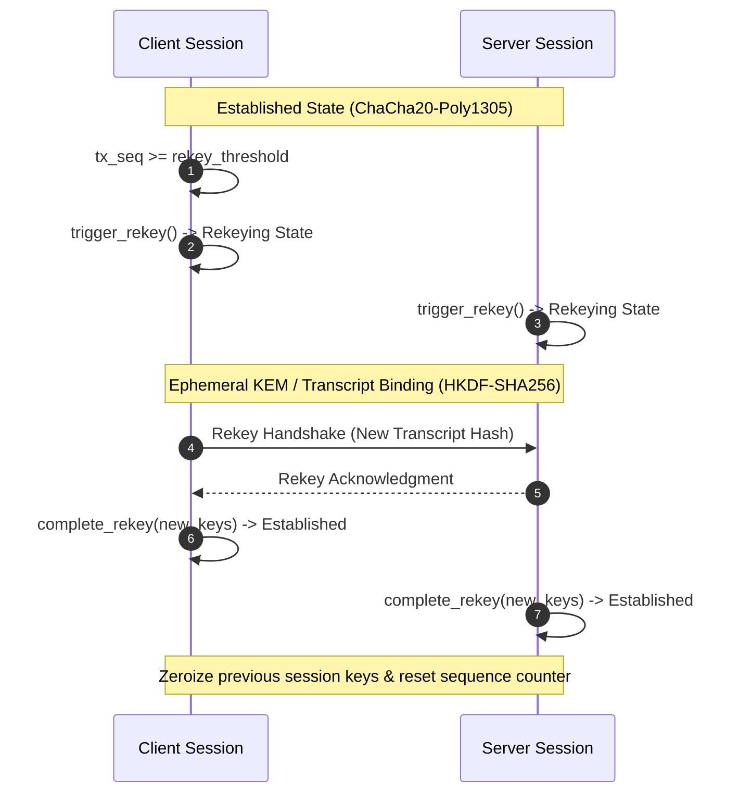

# PQC Hybrid Gateway (`pqc-hybrid-gateway`)

[](https://www.rust-lang.org/)
[](Cargo.toml)
[](https://github.com/Kefmat/qc-hybrid-gateway)
[](https://csrc.nist.gov/pubs/fips/203/final)

A high-performance Post-Quantum Hybrid Cryptographic Gateway and Secure Tunnel engine written in Rust.

The gateway combines NIST-standardized Post-Quantum Cryptography (PQC) algorithms with battle-tested classical primitives in a dual-layer hybrid architecture, ensuring forward security against cryptographically relevant quantum computers (CRQCs) while maintaining classical compliance.

---

## Architectural Scope & Cryptographic Design

### 1. Hybrid Key Encapsulation (KEM)
* **Post-Quantum Primitive**: **ML-KEM-768** (NIST FIPS 203 / Kyber-768)
* **Classical Primitive**: **X25519 ECDH** (RFC 7748)
* **Key Derivation**: Ephemeral shared secrets from both mechanisms are concatenated and passed through **HKDF-SHA256** (`PQC-HYBRID-GATEWAY-KEM-V1`), ensuring the resulting master secret remains secure as long as *at least one* primitive remains unbroken.
* **Forward Secrecy Key Ratcheting**: Continuous symmetric ratchet step derivation (`PQC-HYBRID-GATEWAY-RATCHET-V1`) advancing session write keys with automatic zeroization of past keys.

### 2. Hybrid Signatures & Identity Provenance
* **Post-Quantum Primitive**: **ML-DSA-65** (NIST FIPS 204 / Dilithium3)
* **Classical Primitive**: **Ed25519** (RFC 8032)
* **Verification Semantics**: Dual-signature verification requiring both the Ed25519 and ML-DSA-65 signatures to validate successfully against the composite public key.

### 3. Symmetric Transport & Framing
* **Cipher**: **ChaCha20-Poly1305 AEAD** (RFC 8439)
* **Session Derivation**: Separate client-to-server and server-to-client unidirectional write keys derived from the master secret bound to the handshake transcript hash.
* **Wire Protocol Framing**: Versioned binary framing (`PacketHeader`, `PacketFrame`, `PacketType`) with sequence indexing and payload bounds.
* **Stream Codec**: Incremental buffer frame parser (`FrameDecoder`) supporting chunked streaming and multi-frame processing.
* **Session State Machine**: Comprehensive lifecycle tracking (`Session`, `SessionRole`, `SessionState`) with sequence counters and rekey triggers.
* **Keepalive & Latency Telemetry**: Bidirectional Ping/Pong heartbeat frames with millisecond RTT measurement and structured telemetry reporting.
* **Anti-Replay Defense**: Sliding-window bitmask filter detecting replayed and out-of-order packets.
* **Memory Safety**: Automatic secret key zeroization on drop (`zeroize`).

---

## Cryptographic Parameters Summary

| Component | Classical Primitive | Post-Quantum Primitive | Combined Public Key | Ciphertext / Signature |
|:---|:---|:---|:---|:---|
| **Key Encapsulation** | X25519 (32 B) | ML-KEM-768 (1184 B) | 1216 bytes | 1120 bytes |
| **Digital Signatures** | Ed25519 (32 B) | ML-DSA-65 (1952 B) | 1984 bytes | 3357 bytes |
| **Symmetric AEAD** | ChaCha20-Poly1305 (32 B key, 12 B nonce, 16 B tag) | N/A (Quantum-resistant 256-bit key) | N/A | Variable + 16 B tag |

---

## Wire Protocol Frame Format

All network communication uses a fixed 14-byte binary header followed by the variable-length payload:

```text
 0                   1                   2                   3
 0 1 2 3 4 5 6 7 8 9 0 1 2 3 4 5 6 7 8 9 0 1 2 3 4 5 6 7 8 9 0 1
+-+-+-+-+-+-+-+-+-+-+-+-+-+-+-+-+-+-+-+-+-+-+-+-+-+-+-+-+-+-+-+-+
|    Version    |  Packet Type  |                               |
+-+-+-+-+-+-+-+-+-+-+-+-+-+-+-+-+                               +
|                    Sequence Number (64 bits)                  |
+                               +-+-+-+-+-+-+-+-+-+-+-+-+-+-+-+-+
|                               |       Payload Length (32 bits)|
+-+-+-+-+-+-+-+-+-+-+-+-+-+-+-+-+-+-+-+-+-+-+-+-+-+-+-+-+-+-+-+-+
|                        Payload Data...                        |
+-+-+-+-+-+-+-+-+-+-+-+-+-+-+-+-+-+-+-+-+-+-+-+-+-+-+-+-+-+-+-+-+
```

| Field | Offset | Length | Type | Description |
|:---|:---|:---|:---|:---|
| `version` | 0 | 1 byte | `u8` | Protocol version (`0x01`) |
| `packet_type` | 1 | 1 byte | `u8` | `0x01` (HandshakeInit), `0x02` (HandshakeResp), `0x03` (Data), `0x04` (Ping), `0x05` (Pong) |
| `seq` | 2..10 | 8 bytes | `u64` (big-endian) | Monotonically increasing sequence counter |
| `payload_len` | 10..14 | 4 bytes | `u32` (big-endian) | Payload length in bytes (max 65536 bytes) |
| `payload` | 14.. | Variable | `[u8]` | Encrypted ciphertext or raw handshake payload |

---

## Session State Machine & Lifecycle

The `Session` engine manages tunnel state transitions across the connection lifecycle:

```text
+-------------------+
|   Uninitialized   |
+---------+---------+
          | (establish)
          v
+-------------------+       trigger_rekey()      +-------------------+
|    Established    | -------------------------> |     Rekeying      |
| (encrypt/decrypt) | <------------------------- | (complete_rekey)  |
+---------+---------+                            +-------------------+
          |
          | close()
          v
+-------------------+
|      Closed       |
+-------------------+
```

- **Uninitialized**: Session allocated with defined role (`Client` or `Server`), ciphers unset.
- **Established**: Keys established, sequence numbers active, anti-replay active, data encryption/decryption permitted.
- **Rekeying**: Transition state during key rotation before completing with new `SessionKeys`.
- **Closed**: Terminated session with ciphers zeroized and wiped from memory.

---

## Rust API Quickstart

Add `pqc-hybrid-gateway` to your `Cargo.toml`:

```toml
[dependencies]
pqc-hybrid-gateway = { git = "https://github.com/Kefmat/qc-hybrid-gateway.git" }
```

### Key Encapsulation, Signatures & Wire Framing

```rust
use pqc_hybrid_gateway::crypto::{
    aead::AeadCipher,
    kdf::{derive_session_keys, hash_transcript},
    kem::{decapsulate_hybrid, encapsulate_hybrid, HybridKemKeyPair},
    sig::{sign_hybrid, verify_hybrid, HybridSigKeyPair},
};
use pqc_hybrid_gateway::protocol::{PacketFrame, PacketType};

fn main() -> Result<(), Box<dyn std::error::Error>> {
    // 1. Generate hybrid keypairs
    let receiver_kem = HybridKemKeyPair::generate();
    let sender_sig = HybridSigKeyPair::generate();

    // 2. Hybrid KEM Encapsulation (ML-KEM-768 + X25519)
    let (ciphertext, sender_ss) = encapsulate_hybrid(&receiver_kem.public_key);
    let receiver_ss = decapsulate_hybrid(&ciphertext, &receiver_kem.secret_key);
    assert_eq!(sender_ss, receiver_ss);

    // 3. Hybrid Signature & Verification (ML-DSA-65 + Ed25519)
    let message = b"critical-zero-trust-handshake";
    let signature = sign_hybrid(message, &sender_sig.secret_key);
    assert!(verify_hybrid(message, &signature, &sender_sig.public_key));

    // 4. Derive AEAD session write keys bound to handshake transcript
    let transcript = hash_transcript(&[message, &ciphertext.to_bytes()]);
    let session_keys = derive_session_keys(&sender_ss, &transcript);

    // 5. Encrypt application payload with ChaCha20-Poly1305 and frame
    let cipher = AeadCipher::new(&session_keys.client_write_key);
    let encrypted = cipher.encrypt(1, b"aad-metadata", b"Confidential tunnel traffic")?;
    let frame = PacketFrame::new(PacketType::Data, 1, encrypted)?;
    let wire_bytes = frame.encode();

    assert_eq!(frame.seq(), 1);
    assert_eq!(frame.packet_type(), PacketType::Data);
    Ok(())
}
```

---

## Directory Structure

```text
pqc-hybrid-gateway/
├── Cargo.toml
├── README.md
├── .gitignore
└── src/
    ├── lib.rs              # Core library exports and integration test suite
    ├── main.rs             # CLI interface (info, keygen, verify, bench, tunnel)
    ├── crypto/
    │   ├── mod.rs          # Crypto subsystem declarations
    │   ├── kem.rs          # ML-KEM-768 + X25519 Hybrid Key Encapsulation
    │   ├── sig.rs          # ML-DSA-65 + Ed25519 Hybrid Signatures
    │   ├── aead.rs         # ChaCha20-Poly1305 Authenticated Encryption
    │   └── kdf.rs          # HKDF-SHA256 Transcript Binding & Session Derivation
    ├── protocol/
    │   ├── mod.rs          # Wire framing (PacketHeader, PacketFrame) and anti-replay filter
    │   ├── handshake.rs    # HandshakeInit and HandshakeResponse messages
    │   ├── codec.rs        # FrameDecoder stream codec helper
    │   └── error.rs        # Protocol and packet error types
    └── session/
        └── mod.rs          # Session state machine, rekeying, and bidirectional traffic
```

---

## Building and Running

### Prerequisites
* Rust toolchain (1.75+ recommended)
* Cargo package manager

### Run Unit Tests
```bash
cargo test
```

### Display Cryptographic Specification
Display the cryptographic parameter matrix and protocol architecture:
```bash
cargo run -- info
```

### Run Cryptographic Verification Suite
Runs full end-to-end verification of KEM exchange, signature validation, AEAD tamper detection, anti-replay protection, and wire framing:
```bash
cargo run -- verify
```

### Key Generation
Generate a sample pair of Hybrid KEM and Hybrid Signature public/private keys:
```bash
cargo run -- keygen
```

### Interactive Tunnel Simulation
Simulate a complete end-to-end client-server handshake, streaming frame exchange, keepalive ping/pong with RTT latency measurement, and telemetry reporting:
```bash
# Standard simulation
cargo run -- tunnel

# With network simulation (simulated latency and packet drops)
cargo run -- tunnel --latency-ms 20 --drop-rate 5

# With formatted telemetry report or JSON export
cargo run -- tunnel --report
cargo run -- tunnel --json
```

### Micro-benchmarks
Benchmark the cryptographic primitives (KEM Keygen/Encap/Decap, Signature Sign/Verify, ChaCha20-Poly1305 AEAD Encrypt/Decrypt) locally:
```bash
cargo run --release -- bench
```

---

## Protocol Handshake & Transport Lifecycle

1. **Client Initiation**: The client generates an ephemeral hybrid KEM keypair and transmits a signed `HandshakeInit` message with a nonce.
2. **Server Authentication**: The server encapsulates a shared secret against the client's public key, signs the ciphertext and nonce with its composite identity key (`ML-DSA-65` + `Ed25519`), and returns a `HandshakeResponse`.
3. **Transcript Hash & Key Derivation**: Both peers compute `SHA-256` over the handshake transcript and derive unidirectional AEAD session write keys via `HKDF-SHA256`.
4. **Encrypted Transport**: Application data is packaged into `Data` frames, encrypted using `ChaCha20-Poly1305` with sequential nonce counters and validated against sliding-window anti-replay filters.
5. **Forward Secrecy Key Ratcheting**: Sessions can advance symmetric write keys via one-way HKDF ratcheting (`Session::ratchet_rekey`), zeroizing past keys without requiring asymmetric KEM roundtrips.
6. **Periodic Rekeying**: Upon reaching threshold packet counts or policy intervals, sessions transition through `Rekeying` to rotate session keys with fresh post-quantum entropy.

---

## Security & Implementation Notes

- **Zeroization**: All private keys (`HybridKemSecretKey`, `HybridSigSecretKey`, `SessionKeys`) automatically zeroize underlying memory on drop.
- **Transcript Binding**: All derived session keys are strictly bound to ephemeral exchange transcripts via HKDF-SHA256.
- **Anti-Replay Window**: Uses configurable sliding-window bitmask verification (default window: 64 packets) to prevent packet replay attacks.
- **Memory Safety & Invariants**: All frame lengths and header fields are strictly bounded by `MAX_FRAME_SIZE` (64 KB) with checked constructors.
- **Real-time Telemetry & Diagnostics**: Tracks transmitted/received packets, payload throughput, average packet sizes, dropped replay packets, and rekey rotation counters.

---

## Post-Quantum Rekey Sequence & Threat Model

### Rekeying Protocol Flow



### Threat Model & Quantum Security Guarantees

| Attack Vector | Classical Mitigation | Post-Quantum Protection |
| :--- | :--- | :--- |
| **Harvest Now, Decrypt Later (HNDL)** | X25519 ECDH (Vulnerable to Shor's algorithm) | **ML-KEM-768 (Kyber)** ensures confidentiality remains quantum-safe |
| **Identity Forgery / MitM** | Ed25519 digital signatures | **ML-DSA-65 (Dilithium)** dual hybrid authentication |
| **Packet Tampering & Bit-Flipping** | ChaCha20-Poly1305 AEAD Tag (16B) | Cryptographic MAC bound to per-packet sequence nonces |
| **Replay & Frame Injection** | Sliding-window bitmask filter | Anti-replay filter tracking monotonic 64-packet window |
| **Key Compromise Impersonation (KCI)** | Ephemeral transcript hashing | Forward secrecy enforced via continuous in-session rekeying |

